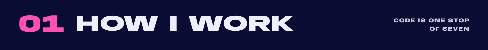
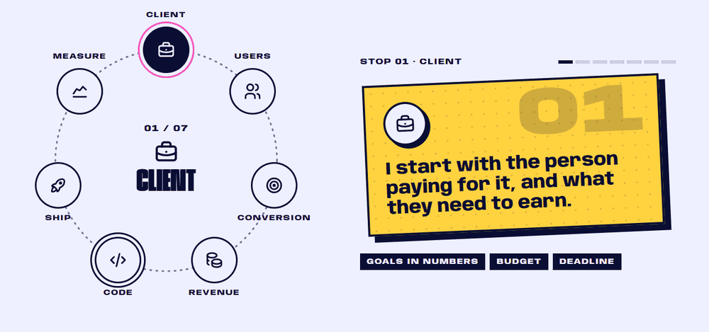
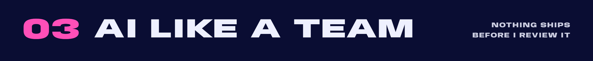
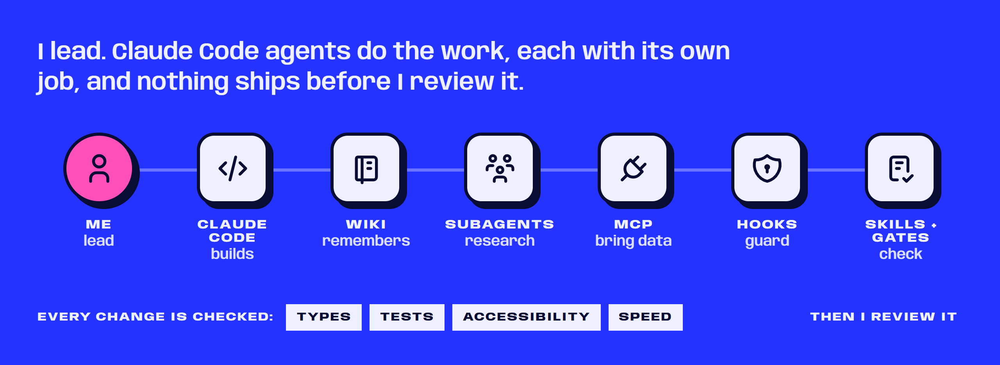
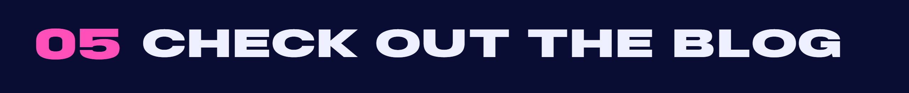
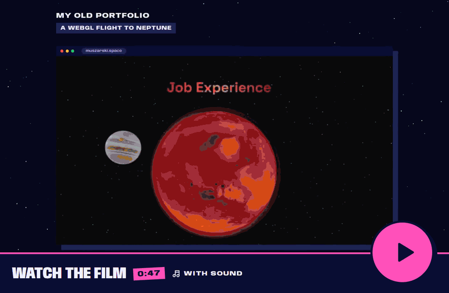
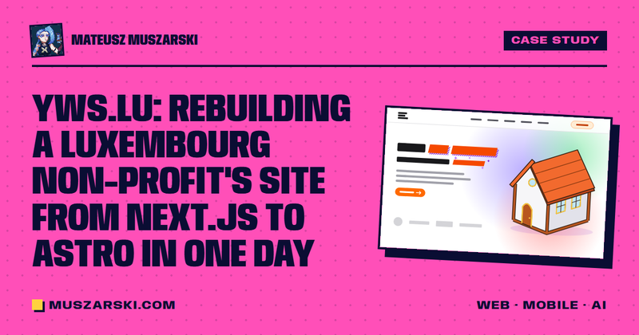
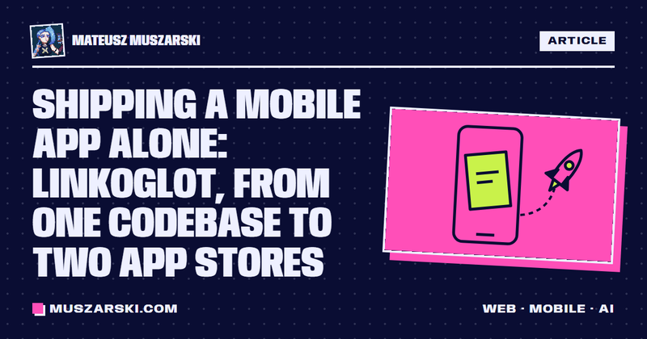
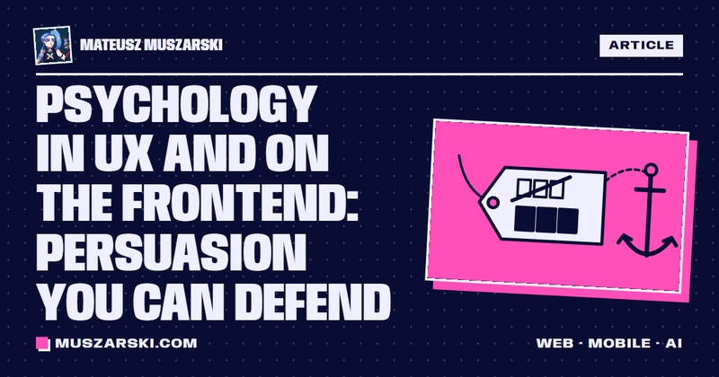
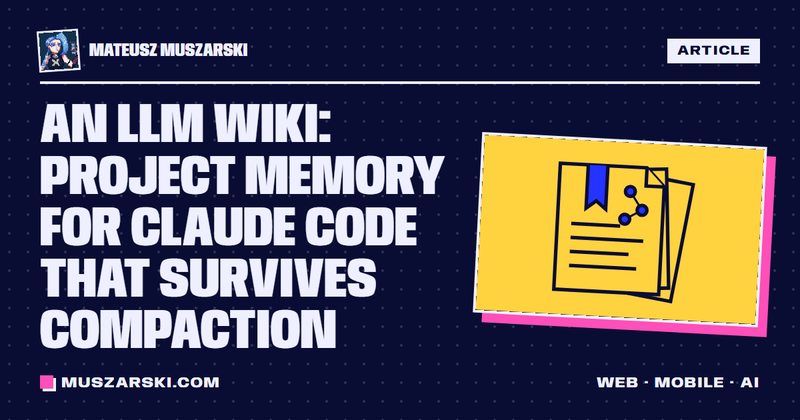

  
  
  
  

 

Hi, I'm **Mateusz** 👋 Full-stack product engineer from Poland. I always think about the users, the business, conversions and the psychology behind my visuals, and I measure my work by the results it brings.

<table>
  <tr><td><b>What I do</b></td><td>Web and mobile products end to end, from the business problem to the shipped app</td></tr>
  <tr><td><b>Now</b></td><td>Intern at Cetuspro, a software house (remote), since June 2026</td></tr>
  <tr><td><b>Shipped</b></td><td>An app of my own on the <a href="https://apps.apple.com/app/id6768303316">App Store</a> and <a href="https://play.google.com/store/apps/details?id=com.linkoglot.app">Google Play</a>, client sites, an <a href="https://www.npmjs.com/package/lingui-translate-ai">npm CLI</a></td></tr>
  <tr><td><b>Looking for</b></td><td>Full-time or contract roles · remote or hybrid</td></tr>
  <tr><td><b>Based in</b></td><td>Pomorskie, Poland (CET) · Polish native, English fluent</td></tr>
</table>

 

<b>The same loop on every project.</b> Code is one stop of seven.

 

<a href="https://pstrykweb.pl"><b>pstrykweb.pl</b></a> &nbsp;·&nbsp; <a href="https://muszarski.com/en/#pstrykweb">More on my site</a>

<a href="https://apps.apple.com/app/id6768303316"><b>App Store</b></a> &nbsp;·&nbsp; <a href="https://play.google.com/store/apps/details?id=com.linkoglot.app"><b>Google Play</b></a> &nbsp;·&nbsp; <a href="https://muszarski.com/en/blog/shipping-a-mobile-app-alone/">How I shipped it alone</a>

<a href="https://muszarski.com/en/#clockful"><b>More on my site</b></a> &nbsp;·&nbsp; code is private (internship)

<a href="https://3d-space-folio.vercel.app/"><b>Fly through it</b></a> &nbsp;·&nbsp; <a href="https://github.com/MuchaSsak/3d-space-portfolio">Code</a> &nbsp;·&nbsp; <a href="https://muszarski.com/en/blog/why-my-threejs-portfolio-was-slow-on-mobile/">Why it was slow on mobile</a>

 

<a href="https://muszarski.com/en/blog/case-study/"><b>How this site was built</b></a> &nbsp;·&nbsp; <a href="https://muszarski.com/en/blog/claude-code-skills-hooks-mcp-subagents/">Skills, hooks, MCP and subagents: which one when</a>

 

<table>
  <tr>
    <td width="50%"></td>
    <td width="50%"></td>
  </tr>
  <tr>
    <td width="50%"></td>
    <td width="50%"></td>
  </tr>
  <tr>
    <td width="50%"></td>
    <td width="50%"></td>
  </tr>
</table>

 

<a href="https://muszarski.com/en/blog/case-study/?film"><b>Watch the film</b></a> (0:47, with sound) &nbsp;·&nbsp; <a href="https://muszarski.com/en/blog/case-study/">Read the case study</a>: trying to build an Awwwards-winning brutalist portfolio

<table>
  <tr>
    <td width="50%"></td>
    <td width="50%"></td>
  </tr>
  <tr>
    <td width="50%"></td>
    <td width="50%"></td>
  </tr>
</table>

<a href="https://muszarski.com/en/blog/"><b>All posts</b></a>, in English and Polish

 

 

<table>
  <tr><td>🧊 <b><a href="https://threejs-journey.com/">Three.js Journey</a></b> by Bruno Simon</td><td>90+ hours of WebGL, shaders and Blender · <a href="https://threejs-journey.com/certificate/view/45175">verify</a></td></tr>
  <tr><td>⚛️ <b>Jonas Schmedtmann's courses</b> on Udemy</td><td><a href="https://www.udemy.com/certificate/UC-8c6e4b4f-2f3f-4c3e-9773-8b2b2f9ee1a7/">The Complete JavaScript Course</a> · <a href="https://www.udemy.com/certificate/UC-f3d532a0-be9d-43e9-b822-0f511752b87c/">The Ultimate React Course</a></td></tr>
  <tr><td>🎓 <b>INF.03</b>, Polish state vocational exam (2024)</td><td>Websites, web applications and databases</td></tr>
  <tr><td>⏱️ <b>Hackathons</b> (2026)</td><td>HackYeah in Kraków · Hack4Change in Gdańsk · Product Challenge: Vibe the Future in Rzeszów</td></tr>
  <tr><td>🌍 <b>Erasmus+ and European Solidarity Corps</b></td><td>Youth projects in <a href="./assets/Digital_Youth_Work_Methods_in_Saraiķi_Latvia.pdf">Latvia</a>, <a href="./assets/Developing_Infrastructure_to_Work_with_Youth_in_Daugirdiškės_Lithuania.pdf">Lithuania</a>, <a href="./assets/Youth_Entrepreneurship_in_Palanga_Lithuania.pdf">Lithuania again</a>, Georgia and Türkiye, all in English</td></tr>
</table>

 

  
  
  

Also in <a href="https://muszarski.com/pl/">Polish</a> and <a href="https://muszarski.com/es/">Spanish</a> on my site. Planet textures in the Space clip: <a href="https://www.solarsystemscope.com/textures/">Solar System Scope</a>, CC BY 4.0.

<picture>
  <source media="(prefers-color-scheme: dark)" srcset="https://raw.githubusercontent.com/MuchaSsak/MuchaSsak/output/github-snake-dark.svg" />
  <source media="(prefers-color-scheme: light)" srcset="https://raw.githubusercontent.com/MuchaSsak/MuchaSsak/output/github-snake.svg" />
  
</picture>
