<a href="https://muszarski.com">
  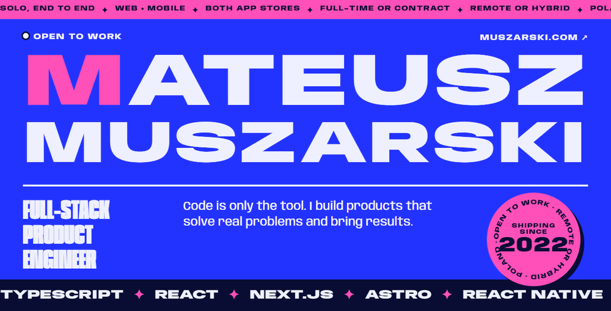
</a>

  <a href="https://muszarski.com">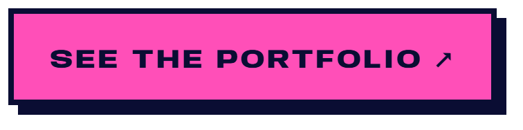</a>
  <a href="https://muszarski.com/files/mateusz-muszarski-cv-en.pdf">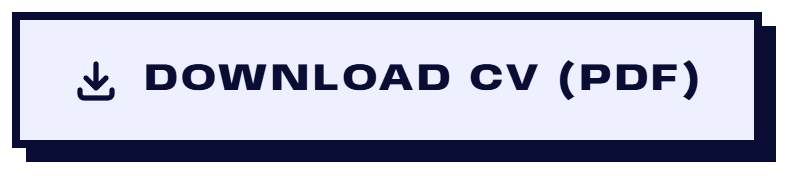</a>
  <a href="https://www.linkedin.com/in/mateusz-muszarski-b1168a28a/">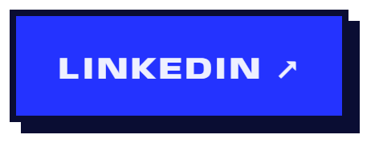</a>
  <a href="mailto:hi@muszarski.com">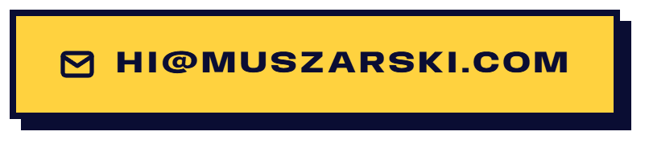</a>

 

Hi, I'm **Mateusz** 👋 I build web and mobile products end to end, from the business problem to the shipped app. I use AI agents (Claude Code) to do more, and I keep the decisions and the checking: tests, accessibility and performance on every change.

<table>
  <tr><td><b>Role</b></td><td>Full-stack product engineer · TypeScript, React, Next.js, React Native, Supabase</td></tr>
  <tr><td><b>Now</b></td><td>Intern at Cetuspro, a software house (remote), since June 2026</td></tr>
  <tr><td><b>Shipped</b></td><td>An app of my own on the <a href="https://apps.apple.com/app/id6768303316">App Store</a> and <a href="https://play.google.com/store/apps/details?id=com.linkoglot.app">Google Play</a>, client sites, an <a href="https://www.npmjs.com/package/lingui-translate-ai">npm CLI</a></td></tr>
  <tr><td><b>Looking for</b></td><td>Full-time or contract roles · remote or hybrid</td></tr>
  <tr><td><b>Based in</b></td><td>Pomorskie, Poland (CET) · Polish native, English fluent</td></tr>
</table>

 

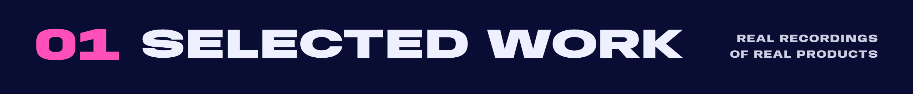

<a href="https://muszarski.com/en/#pstrykweb">
  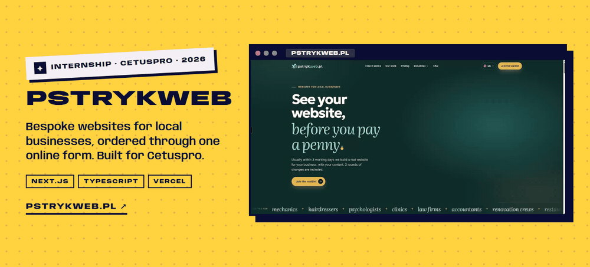
</a>

<a href="https://pstrykweb.pl"><b>pstrykweb.pl</b></a> &nbsp;·&nbsp; <a href="https://muszarski.com/en/#pstrykweb">More on my site</a>

<a href="https://muszarski.com/en/#linkoglot">
  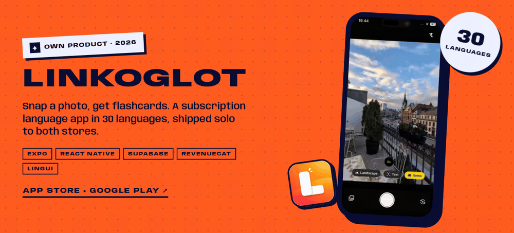
</a>

<a href="https://apps.apple.com/app/id6768303316"><b>App Store</b></a> &nbsp;·&nbsp; <a href="https://play.google.com/store/apps/details?id=com.linkoglot.app"><b>Google Play</b></a> &nbsp;·&nbsp; <a href="https://muszarski.com/en/blog/shipping-a-mobile-app-alone/">How I shipped it alone</a>

<a href="https://muszarski.com/en/#clockful">
  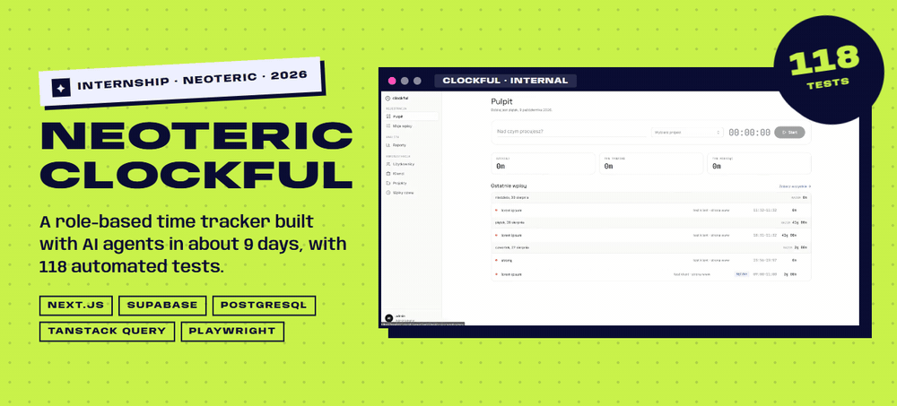
</a>

<a href="https://muszarski.com/en/#clockful"><b>More on my site</b></a> &nbsp;·&nbsp; code is private (internship)

<a href="https://3d-space-folio.vercel.app/">
  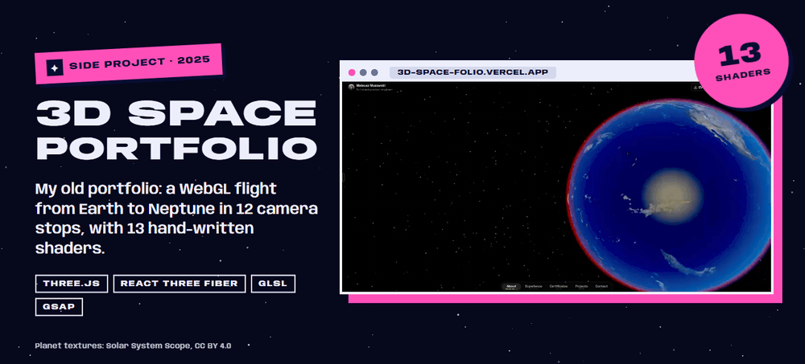
</a>

<a href="https://3d-space-folio.vercel.app/"><b>Fly through it</b></a> &nbsp;·&nbsp; <a href="https://github.com/MuchaSsak/3d-space-portfolio">Code</a> &nbsp;·&nbsp; <a href="https://muszarski.com/en/blog/why-my-threejs-portfolio-was-slow-on-mobile/">Why it was slow on mobile</a>

 

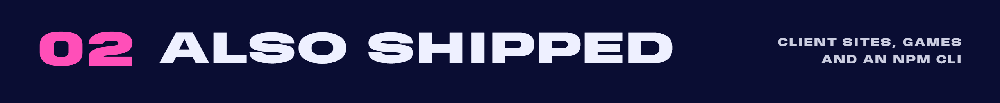

<table>
  <tr>
    <td width="50%"><a href="https://muszarski.com">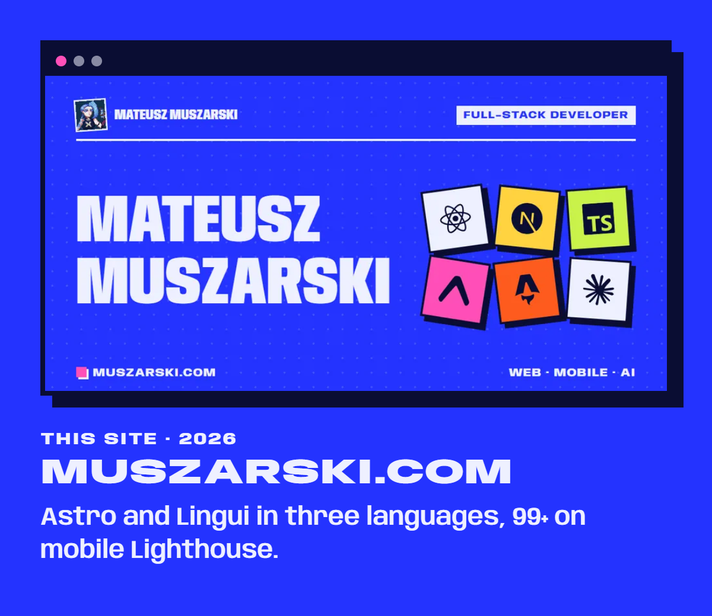</a></td>
    <td width="50%"><a href="https://yws.lu">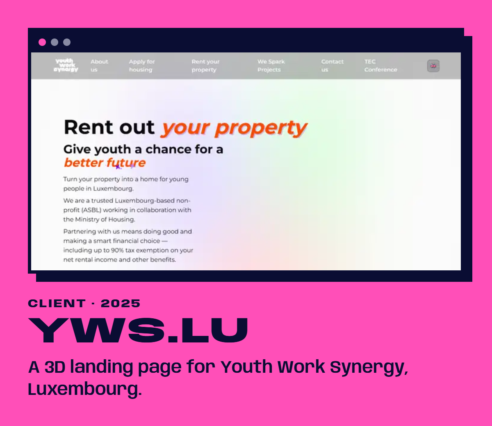</a></td>
  </tr>
  <tr>
    <td width="50%"><a href="https://malatro.vercel.app">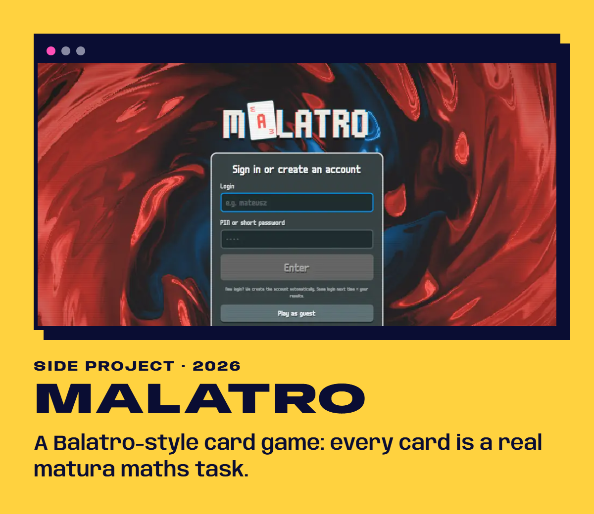</a></td>
    <td width="50%"><a href="https://www.npmjs.com/package/lingui-translate-ai">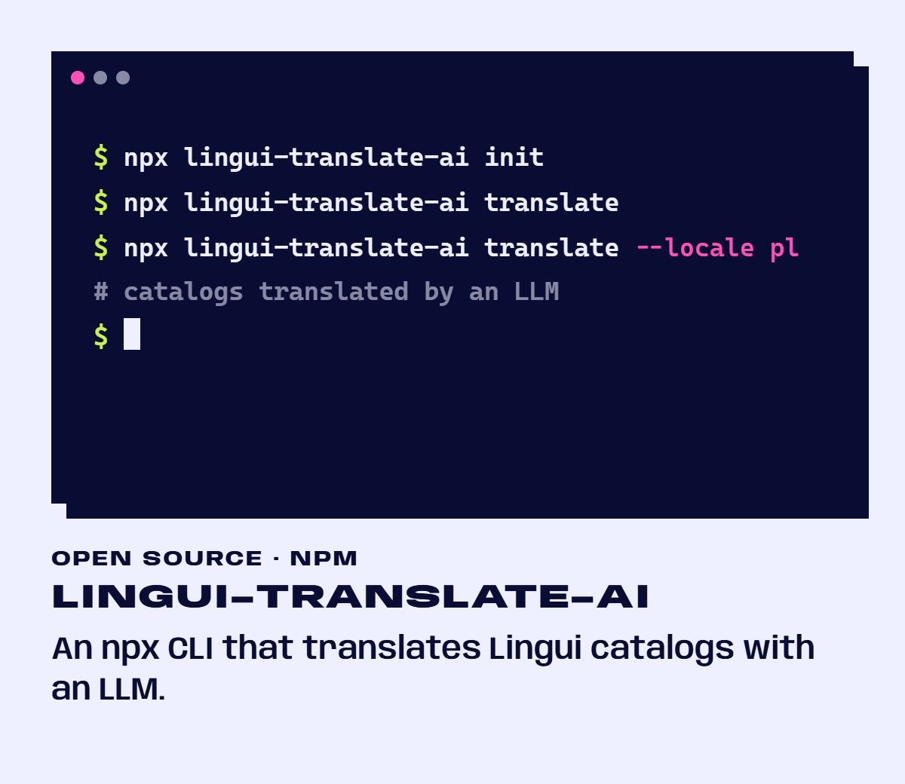</a></td>
  </tr>
  <tr>
    <td width="50%"><a href="https://lingotype.vercel.app">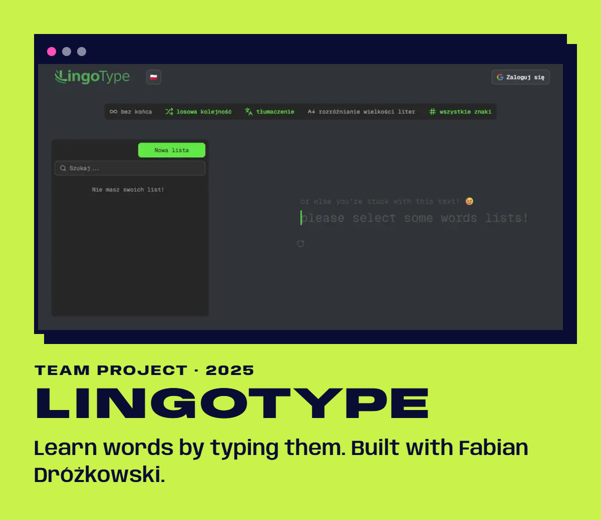</a></td>
    <td width="50%"><a href="https://github.com/MuchaSsak?tab=repositories">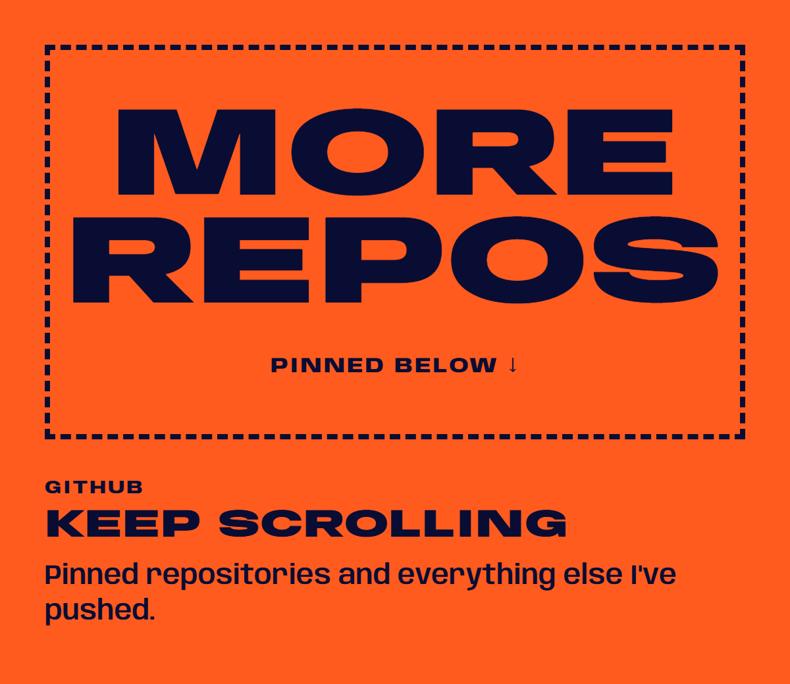</a></td>
  </tr>
</table>

 

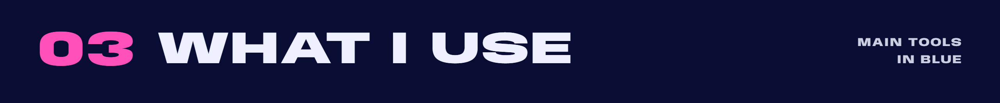

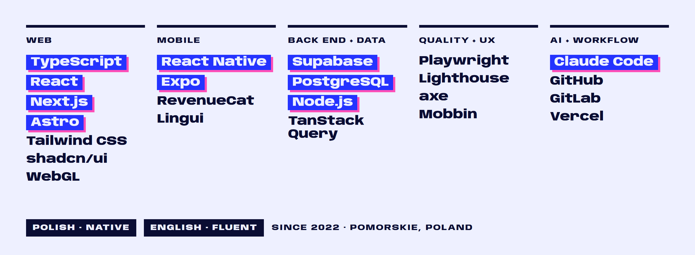

 

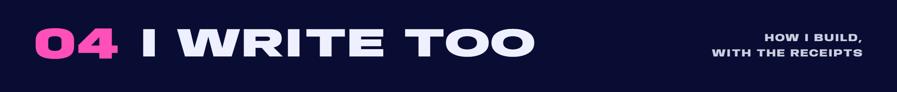

- [**Trying to build an Awwwards-winning brutalist portfolio**](https://muszarski.com/en/blog/case-study/): the process, the mindset and the tools
- [**Shipping a mobile app alone**](https://muszarski.com/en/blog/shipping-a-mobile-app-alone/): Linkoglot, from one codebase to two app stores
- [**yws.lu: from Next.js to Astro in one day**](https://muszarski.com/en/blog/yws-lu-case-study/): rebuilding a Luxembourg non-profit's site
- [**Why my three.js portfolio was slow on mobile**](https://muszarski.com/en/blog/why-my-threejs-portfolio-was-slow-on-mobile/), and what a 3D site needs
- [**An LLM wiki for Claude Code**](https://muszarski.com/en/blog/llm-wiki-project-memory-for-claude-code/): project memory that survives compaction
- [**Lighthouse scores of 16 developer portfolios**](https://muszarski.com/en/blog/lighthouse-scores-of-16-developer-portfolios/): immersive vs minimal

All posts, in English and Polish: <a href="https://muszarski.com/en/blog/">muszarski.com/blog</a>

 

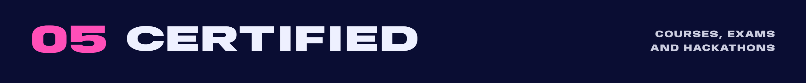

<table>
  <tr><td>🧊 <b><a href="https://threejs-journey.com/">Three.js Journey</a></b> by Bruno Simon</td><td>90+ hours of WebGL, shaders and Blender · <a href="https://threejs-journey.com/certificate/view/45175">verify</a></td></tr>
  <tr><td>⚛️ <b>Jonas Schmedtmann's courses</b> on Udemy</td><td><a href="https://www.udemy.com/certificate/UC-8c6e4b4f-2f3f-4c3e-9773-8b2b2f9ee1a7/">The Complete JavaScript Course</a> · <a href="https://www.udemy.com/certificate/UC-f3d532a0-be9d-43e9-b822-0f511752b87c/">The Ultimate React Course</a></td></tr>
  <tr><td>🎓 <b>INF.03</b>, Polish state vocational exam (2024)</td><td>Websites, web applications and databases</td></tr>
  <tr><td>⏱️ <b>Hackathons</b> (2026)</td><td>HackYeah in Kraków · Hack4Change in Gdańsk · Product Challenge: Vibe the Future in Rzeszów</td></tr>
  <tr><td>🌍 <b>Erasmus+ and European Solidarity Corps</b></td><td>Youth projects in <a href="./assets/Digital_Youth_Work_Methods_in_Saraiķi_Latvia.pdf">Latvia</a>, <a href="./assets/Developing_Infrastructure_to_Work_with_Youth_in_Daugirdiškės_Lithuania.pdf">Lithuania</a>, <a href="./assets/Youth_Entrepreneurship_in_Palanga_Lithuania.pdf">Lithuania again</a>, Georgia and Türkiye, all in English</td></tr>
</table>

 

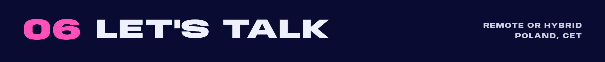

  
  
  

Also in <a href="https://muszarski.com/pl/">Polish</a> and <a href="https://muszarski.com/es/">Spanish</a> on my site. Planet textures in the Space clip: <a href="https://www.solarsystemscope.com/textures/">Solar System Scope</a>, CC BY 4.0.

<picture>
  <source media="(prefers-color-scheme: dark)" srcset="https://raw.githubusercontent.com/MuchaSsak/MuchaSsak/output/github-snake-dark.svg" />
  <source media="(prefers-color-scheme: light)" srcset="https://raw.githubusercontent.com/MuchaSsak/MuchaSsak/output/github-snake.svg" />
  
</picture>
